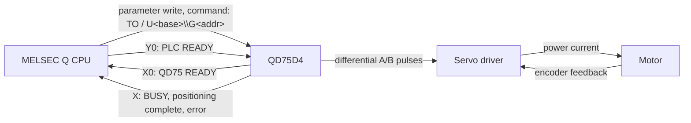

# QD75D4 — 4-axis positioning module

The QD75D4 is a positioning module mounted on the base of a MELSEC Q PLC, outputting pulses to control a servo/stepper driver. The module holds the position data and performs positioning independently of the CPU scan program; the CPU only writes parameters, issues commands and reads status.

## 1. Core specifications

<ParamTable :rows="specRows" title="QD75D4 specifications" />

## 2. Block diagram

Two-way handshake: the CPU turns on Y0 to enable the module, and the module turns on X0 when it is ready; the other status flags go through the X inputs. See [X/Y signals](/en/q/qd75/io-signals) for details.

## 3. Choosing a model in the QD75 family

| Model | Output | Number of axes | Notes |
| --- | --- | --- | --- |
| QD75P1 | Open collector | 1 | Discontinued 09/2021, replaced by QD75P1N |
| QD75P2 | Open collector | 2 | Discontinued 09/2021, replaced by QD75P2N |
| QD75P4 | Open collector | 4 | Discontinued 09/2021, replaced by QD75P4N |
| QD75D1 | Differential driver | 1 | Discontinued 09/2021, replaced by QD75D1N |
| QD75D2 | Differential driver | 2 | Discontinued 09/2021, replaced by QD75D2N |
| QD75D4 | Differential driver | 4 | Discontinued 09/2021, replaced by QD75D4N |

The variants with the N suffix (QD75P1N … QD75D4N) are the current replacements (FA-A-0286). The full twelve-model table is on the [MELSEC Q page](/en/q/).

Discontinuation dates per SH-080058 appendix A-19 (discontinued model list); the N versions are the replacement products (FA-A-0286, SH-080058 appendix 1.2). Open collector / differential output type per SH-080058 §3.1 p.3-2.

## 4. Documentation scope

In scope:

- Differential pulse wiring, X/Y signals, Pr. parameters, Da. position data, OPR, startup ladder, commissioning and troubleshooting.
- Pulse-based positioning to a conventional servo/stepper driver.

Out of scope:

- SSCNET (control over a high-speed communication cable) — belongs to a different module family.
- Multi-axis synchronous control by cam or virtual axis — belongs to motion modules, not the QD75.
- Replacing hardware safety checks with software.

## 5. Detail pages

- [Wiring](/en/q/qd75/wiring) — differential pairing, wiring principles, checklist before power-up.
- [X/Y signals](/en/q/qd75/io-signals) — READY handshake, axis flags, refresh timing.
- [Parameters (Pr.)](/en/q/qd75/parameters) — units, pulses/revolution, travel/revolution, magnification, two parameter write paths.
- [Position data (Da.)](/en/q/qd75/position-data) — ten data fields, three control systems, 600-point limit.
- [Origin point return (OPR)](/en/q/qd75/opr) — the OPR methods (Pr.43 codes) and the sequence.
- [Ladder](/en/q/qd75/ladder) — buffer memory access, startup sequence, safety interlocks.
- [Commissioning](/en/q/qd75/commissioning) — procedure from power-up to loaded operation.
- [Troubleshooting](/en/q/qd75/troubleshooting) — indicators, error groups, how to look up error codes.
