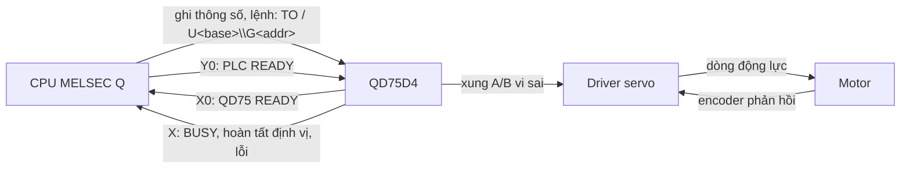

# QD75D4 — module vị trí 4 trục

QD75D4 là module vị trí gắn trên base của PLC MELSEC Q, phát xung điều khiển tới driver servo/step. Module giữ dữ liệu vị trí và thực hiện định vị độc lập với chương trình quét của CPU; CPU chỉ ghi thông số, phát lệnh và đọc trạng thái.

## 1. Thông số cốt lõi

<ParamTable :rows="specRows" title="Thông số QD75D4" />

## 2. Sơ đồ khối

Bắt tay hai chiều: CPU bật Y0 để cho phép module, module bật X0 khi đã sẵn sàng; các cờ trạng thái khác đi qua ngõ X. Chi tiết xem [tín hiệu X/Y](/q/qd75/io-signals).

## 3. Chọn model trong họ QD75

| Model | Ngõ ra | Số trục | Ghi chú |
| --- | --- | --- | --- |
| QD75P1 | Open collector | 1 | Ngừng sản xuất 09/2021, thay bằng QD75P1N |
| QD75P2 | Open collector | 2 | Ngừng sản xuất 09/2021, thay bằng QD75P2N |
| QD75P4 | Open collector | 4 | Ngừng sản xuất 09/2021, thay bằng QD75P4N |
| QD75D1 | Differential driver | 1 | Ngừng sản xuất 09/2021, thay bằng QD75D1N |
| QD75D2 | Differential driver | 2 | Ngừng sản xuất 09/2021, thay bằng QD75D2N |
| QD75D4 | Differential driver | 4 | Ngừng sản xuất 09/2021, thay bằng QD75D4N |

Biến thể có hậu tố N (QD75P1N … QD75D4N) là bản thay thế hiện hành (FA-A-0286). Bảng đầy đủ mười hai model ở [trang MELSEC Q](/q/).

Ngày ngừng sản xuất theo SH-080058 phụ lục A-19 (danh mục model ngừng sản xuất); bản N là sản phẩm thay thế (FA-A-0286, SH-080058 phụ lục 1.2). Kiểu ngõ ra open collector / vi sai theo SH-080058 §3.1 p.3-2.

## 4. Phạm vi tài liệu

Trong phạm vi:

- Đấu dây xung vi sai, tín hiệu X/Y, thông số Pr., dữ liệu vị trí Da., OPR, ladder khởi động, chạy thử và xử lý sự cố.
- Định vị bằng xung tới driver servo/step thông thường.

Ngoài phạm vi:

- SSCNET (điều khiển bằng cáp truyền thông tốc độ cao) — thuộc họ module khác.
- Điều khiển đồng bộ nhiều trục theo cam hoặc trục ảo — thuộc motion module, không thuộc QD75.
- Thay thế kiểm tra an toàn phần cứng bằng phần mềm.

## 5. Các trang chi tiết

- [Đấu dây](/q/qd75/wiring) — ghép cặp vi sai, nguyên tắc đi dây, checklist trước khi cấp điện.
- [Tín hiệu X/Y](/q/qd75/io-signals) — bắt tay READY, cờ trục, thời điểm làm mới.
- [Thông số (Pr.)](/q/qd75/parameters) — đơn vị, xung/vòng, quãng đường/vòng, hệ số nhân, hai đường ghi thông số.
- [Dữ liệu vị trí (Da.)](/q/qd75/position-data) — mười trường dữ liệu, ba hệ điều khiển, giới hạn 600 điểm.
- [Về gốc toạ độ (OPR)](/q/qd75/opr) — các phương pháp OPR (mã Pr.43) và trình tự.
- [Ladder](/q/qd75/ladder) — truy cập buffer memory, trình tự khởi động, liên động an toàn.
- [Chạy thử](/q/qd75/commissioning) — quy trình từ cấp điện tới chạy có tải.
- [Xử lý sự cố](/q/qd75/troubleshooting) — chỉ báo, nhóm lỗi, cách tra mã lỗi.
